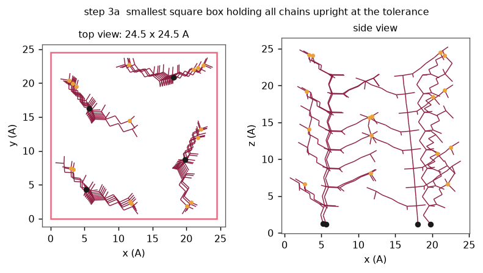
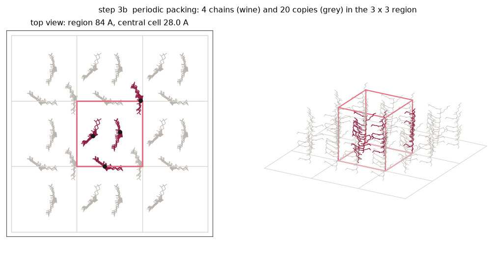
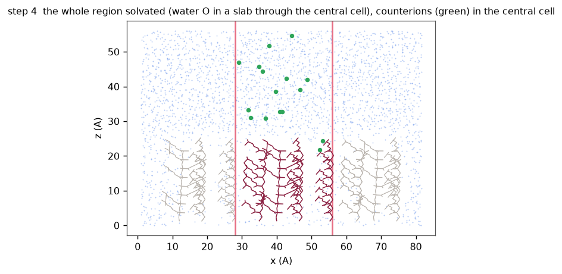

# Tutorial: a PDMAEMA brush from monomers to a periodic simulation box

This tutorial builds the small test brush of `examples/pdmaema/config_quick.toml` (4 chains of 8 units, half of the
units protonated) and explains every step. The same commands with `config.toml` build the brush of the paper
(16 chains of 30 units); only the packing takes longer.

The images were made from the output of this run with `docs/make_tutorial_images.py`
(`python3 make_tutorial_images.py <output folder>` draws them for any run). PACKMOL uses random seeds, so numbers in
your run will differ slightly.

Colours: chains of the simulation box wine, periodic copies grey, N of protonated units amber, grafted atoms black,
water blue, Cl⁻ green, central cell or box rose.

---

## 0. Setup

```bash
source $AMBERHOME/amber.sh                         # AmberTools: prepgen, parmchk2, tleap
export PATH=/path/to/packmol-20.4.0:$PATH          # or set [tools] packmol in the configuration
cd md/brush_builder/examples/pdmaema
```

Python ≥ 3.11 with numpy is all the tool needs (`scipy` and `matplotlib` only for the tutorial images).

## 1. Inputs

**Monomers.** One antechamber file with RESP charges per monomer type. For PDMAEMA these are the two stereoisomers
of the DMAEMA unit (A, B), unprotonated (`dda.ac`, `ddb.ac`) and protonated (`dpa.ac`, `dpb.ac`), in `monomers/`.
They were made from Gaussian Merz–Kollman potentials (inputs in `qm/`, B3LYP-D3(BJ)/def2-SVP) with

```bash
antechamber -fi gesp -fo ac -i dpa.esp -o dpa.ac -c resp -pf y -at gaff2 -eq 1
```

**Configuration.** Everything else is set in a TOML file. The parts that matter most:

```toml
[monomers]                     # key -> residues H<key> (head), D<key> (middle), T<key> (tail)
PA = { ac = "monomers/dpa.ac", protonated = true }
...
[residues]                     # atom names in the monomer files
head_name = "C7"               # backbone atom bonded to the previous unit
tail_name = "C6"               # backbone atom bonded to the next unit
end_group_atoms = ["C8", "H13", "H14", "H15"]   # methyl end group, kept only by the head unit
cap_atom = "H19"               # H cap, kept only by the tail unit
[chains]
n_chains = 4
n_units = 8
alpha = 0.5                    # fraction of protonated units
[brush]
tolerance = 5.0                # minimum distance between chains (A): sets the grafting density
```

## 2. Step 1: residues (`params`)

```bash
python3 ../../brush_builder.py config_quick.toml params
```

For every monomer type, `prepgen` makes a head, a middle and a tail residue, and `parmchk2` adds missing GAFF2
parameters. The `mainchain` definitions are generated from `[residues]`, for example the middle unit of the
protonated monomer (`output_quick/params/mainchain.dpa`):

```
HEAD_NAME C7
TAIL_NAME C6
OMIT_NAME C8          # the end group and the H cap are removed in middle units
OMIT_NAME H13
OMIT_NAME H14
OMIT_NAME H15
OMIT_NAME H19
PRE_HEAD_TYPE c3
POST_TAIL_TYPE c3
CHARGE 1.0
```

Output: 12 residues (`hpa.prepi`, `dpa.prepi`, `tpa.prepi`, ...) and their `.frcmod` files.

## 3. Step 2: chains (`chains`)

```bash
python3 ../../brush_builder.py config_quick.toml chains
```

```
chain 1: HPB DDB DPA DDA DDB DPA DDB TPB (aligned, 25 A long, 15 A wide)
chain 2: HDB DDA DDA DPA DPA DPB DDA TPB (aligned, 25 A long, 16 A wide)
...
```

Every chain gets exactly `round(alpha * n_units)` protonated units (here 4 of 8) at random positions, and a random
stereoisomer for every unit (atactic). `tleap` builds the chain, which is then turned upright: its longest axis
onto z, the grafted atom (`anchor_atom`, the second atom of the head unit) at the bottom.


## 4. Step 3: packing with periodic boundaries (`pack`)

```bash
python3 ../../brush_builder.py config_quick.toml pack
```

**(a) Smallest box.** PACKMOL places all chains upright, with their grafted atoms on the plane `anchor_z`, and
keeps every pair of chains at least `tolerance` apart. The square box is widened in steps of `box_step` until this
works:

```
pack (a): all chains fit in 24.50 x 24.50 A at tolerance 5.0 A
```



This box knows nothing about periodic boundaries yet: a chain at its left edge could overlap with the periodic
image of a chain at its right edge.

**(b) Periodic packing.** The chains are packed again in a region of 3 × 3 cells. Each chain is placed with its
grafted atom inside the central cell, against all chains placed before *and their copies*, and is then copied into
the 8 neighbouring cells. Only copies that reach to within half a cell of the central cell are kept; the others
cannot come close to it. So every new chain sees the periodic images of the previous ones, which PACKMOL 20 cannot
do by itself.

```
pack (b): region 74.0 A, central cell 24.67 A
  chain 1/4 placed (3 copies so far, 0 failed packings)
  chain 2/4 placed (10 copies so far, 0 failed packings)
  chain 3/4 placed (15 copies so far, 1 failed packings)
  chain 1/4 placed (3 copies so far, 3 failed packings)      <- chain 4 failed twice: restart with chain 1
  ...
pack (b): region 75.0 A, central cell 25.00 A               <- max_fail failures: region 1 A larger
  ...
pack: 4 chains and 20 copies, cell 28.00 A, grafting density 0.51 nm^-2
```

If a chain cannot be placed in `max_attempts` tries, the packing starts again with chain 1 (a different random
arrangement); after `max_fail` failed packings the region grows by `region_step`. The final central cell is the
simulation box; its size gives the grafting density.



The copies near the edges of the central cell are what keeps the brush consistent across the periodic boundaries:
the chain at the top right edge of the central cell (top view) was packed against copies of the chains on the
opposite side.

## 5. Step 4: solvation and the periodic box (`solvate`)

```bash
python3 ../../brush_builder.py config_quick.toml solvate
```

```
solvation pass 1: 10563 water molecules, 1.250 g/cm3 in the water layer above the solute
solvation pass 2: 8451 water molecules, 1.007 g/cm3 in the water layer above the solute
cut: 27 water molecules removed that clashed across the periodic boundaries
tleap: system.prmtop written, total charge -0.000001
restraint mask of the grafted units (keep them on their plane during MD): :1,9,17,25
solvate: box 28.00 x 28.00 x 58.02 A, 4 chains, 836 water, 16 ions
```

The whole region, copies included, is filled with water: `shell_xy` beyond the polymer laterally and `shell_z`
above the brush. One Cl⁻ per protonated unit goes into the central cell. The first water count is mass based (box
volume at the target density minus the solute mass); because the polymer excludes more volume than its mass
suggests, the water is too dense at first (1.25 g/cm³), and the count is corrected until the free water above the
brush has the target density.



Then everything outside the central cell is removed (the rose lines mark the cut): the copies, and every water
molecule whose O lies outside. Water molecules near opposite faces of the box may now overlap across the periodic
boundary (the water of the neighbouring cells was not a copy of the central cell); those closer than 2 Å to another
molecule are removed. `tleap` writes the periodic system with GAFF2 and TIP3P:


Output in `output_quick/solvate/`: `system.prmtop`, `system.inpcrd`, `system.pdb`, and `system.json` with the box,
the numbers of molecules and the restraint mask.

## 6. Running the MD

The grafted units stand for the attachment to the polystyrene wall and are kept on their plane with a positional
restraint (10 kcal mol⁻¹ Å⁻² in the paper). The mask is in `system.json`. A minimisation with the brush restrained:

```
minimisation, grafted units restrained
 &cntrl
  imin=1, maxcyc=10000, ncyc=5000,
  ntb=1, cut=10.0,
  ntr=1, restraint_wt=10.0, restraintmask=':1,9,17,25',
 /
```

```bash
pmemd -O -i min.in -p system.prmtop -c system.inpcrd -ref system.inpcrd -r min.ncrst -o min.out
```

Keep `ntr=1` with the same mask in heating, equilibration and production (constant pressure, `ntb=2`, `ntp=1`), as
in the paper.

## 7. Adapting the model

| Change | Where |
|---|---|
| grafting density | `[brush] tolerance` (larger tolerance, sparser brush; 2, 5 and 10 Å gave 0.68, 0.39 and 0.21 nm⁻² for 16 × 30-mers) |
| chain length, number of chains, protonation degree | `[chains] n_units`, `n_chains`, `alpha` |
| reproducible sequences | `[chains] seed` |
| water above the brush, lateral shell | `[solvent] shell_z`, `shell_xy` |
| counterion | `[solvent] counterion` (residue and atom name, e.g. `"Cl-"`, `"Na+"`) |
| other monomer | new antechamber files in `[monomers]` and their atom names in `[residues]` |
| single chains in water | `python3 ../../brush_builder.py config.toml single` (shell `shell_single`) |

## 8. Troubleshooting

- **The packing (step 3b) takes very long.** It is a random search: with dense brushes most attempts fail and the
  region grows only after `max_fail` failures. A larger `tolerance` gives a sparser brush and packs faster; a smaller
  `max_fail` lets the region grow sooner (at the cost of a lower grafting density than the densest possible).
- **PACKMOL is not found.** Set `[tools] packmol` to the full path of the executable.
- **tleap reports unknown residues or atoms.** Check that the atom names in `[residues]` exist in the monomer files
  and that `prepgen` ran without errors (`output/params/`).
- **Re-running a step.** Each step reads the output of the previous one; delete its output folder
  (e.g. `output_quick/pack`) and run the step again.
