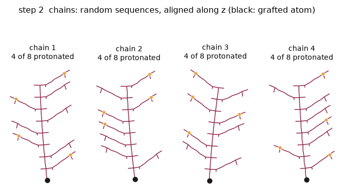
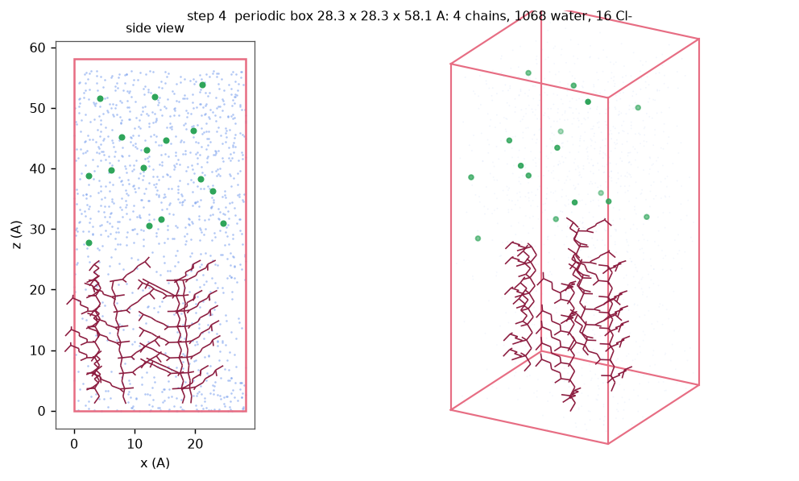
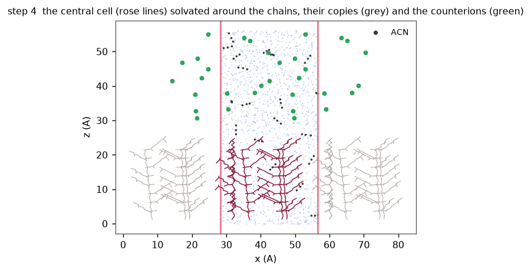
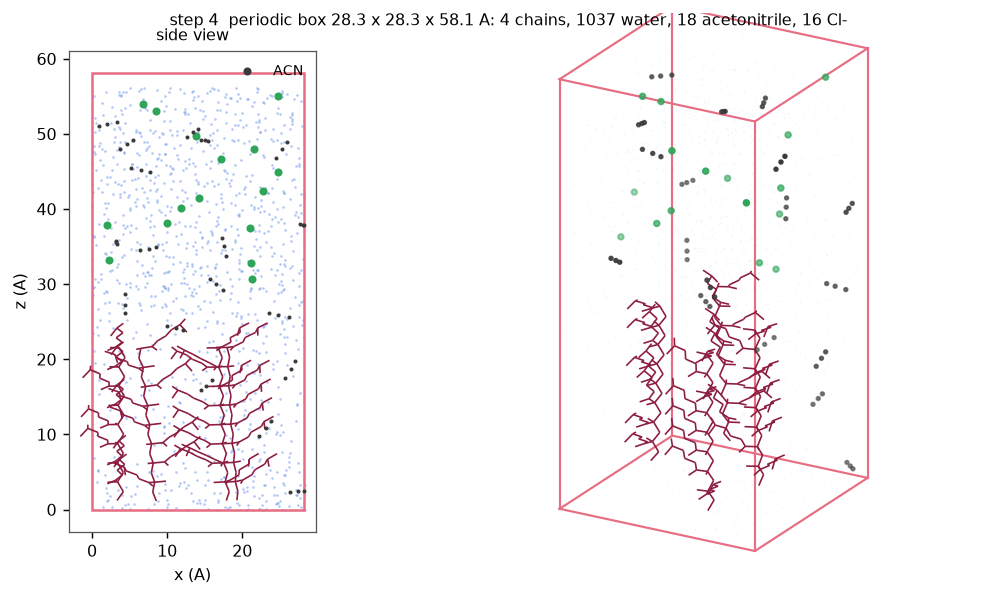

# Tutorial: a PDMAEMA brush from monomers to a periodic simulation box

This tutorial builds the small test brush of `examples/pdmaema/config_quick.toml` (4 chains of 8 units, half of the
units protonated, 0.5 chains per nm², water) and then the same brush in a water/acetonitrile mixture
(`config_mixture.toml`). The same commands with `config_paper.toml` build the brush of the paper (16 chains of 30
units); only the packing takes longer.

The images were made from the output of these runs with `docs/make_tutorial_images.py`
(`python3 make_tutorial_images.py <output folder> [<image folder>] [<prefix>]` draws them for any run). PACKMOL
uses random seeds, so numbers in your run will differ slightly.

Colours: chains of the simulation box wine, periodic copies grey, N of protonated units amber, grafted atoms black,
water blue, Cl⁻ green, other solvents dark grey, central cell or box rose.

---

## 0. Setup

```bash
source $AMBERHOME/amber.sh                         # AmberTools: prepgen, parmchk2, tleap
export PATH=/path/to/packmol-20.4.0:$PATH          # or set [tools] packmol in the configuration
cd md/brush_builder/examples/pdmaema
```

Python ≥ 3.11 with numpy and scipy (and matplotlib for the tutorial images).

## 1. Inputs

**Monomers.** One antechamber file with RESP charges per monomer type. For PDMAEMA these are the two stereoisomers
of the DMAEMA unit (A, B), unprotonated (`dda.ac`, `ddb.ac`) and protonated (`dpa.ac`, `dpb.ac`), in `monomers/`.
They were made from Gaussian Merz–Kollman potentials (inputs in `qm/`, B3LYP-D3(BJ)/def2-SVP) with

```bash
antechamber -fi gesp -fo ac -i dpa.esp -o dpa.ac -c resp -pf y -at gaff2 -eq 1
```

**Configuration.** Everything else is set in a TOML file. The parts that matter most:

```toml
[monomers]                     # key -> residues H<key> (head), D<key> (middle), T<key> (tail)
PA = { ac = "monomers/dpa.ac", protonated = true }
...
[residues]                     # atom names in the monomer files
head_name = "C7"               # backbone atom bonded to the previous unit
tail_name = "C6"               # backbone atom bonded to the next unit
end_group_atoms = ["C8", "H13", "H14", "H15"]   # methyl end group, kept only by the head unit
cap_atom = "H19"               # H cap, kept only by the tail unit
[chains]
n_units = 8
alpha = 0.5                    # fraction of protonated units
[brush]
chains_per_box = 4
grafting_density = 0.5         # chains per nm^2: the box side follows, sqrt(4 / 0.5) nm = 28.3 A
min_distance = 5.0             # minimum distance between chains during packing (A)
[solvent]
water_model = "tip3p"
layer = 30.0                   # solvent above the brush (A)
[[solvent.components]]
name = "water"
fraction = 100
```

## 2. Step 1: residues (`params`)

```bash
python3 ../../brush_builder.py config_quick.toml params
```

For every monomer type, `prepgen` makes a head, a middle and a tail residue, and `parmchk2` adds missing GAFF2
parameters. The `mainchain` definitions are generated from `[residues]`, for example the middle unit of the
protonated monomer (`output_quick/params/mainchain.dpa`):

```
HEAD_NAME C7
TAIL_NAME C6
OMIT_NAME C8          # the end group and the H cap are removed in middle units
OMIT_NAME H13
OMIT_NAME H14
OMIT_NAME H15
OMIT_NAME H19
PRE_HEAD_TYPE c3
POST_TAIL_TYPE c3
CHARGE 1.0
```

Output: 12 residues (`hpa.prepi`, `dpa.prepi`, `tpa.prepi`, ...) and their `.frcmod` files.

## 3. Step 2: chains (`chains`)

```bash
python3 ../../brush_builder.py config_quick.toml chains
```

```
chain 1: HPB DDB DPA DDA DDB DPA DDB TPB (aligned, 25 A long)
chain 2: HDB DDA DDA DPA DPA DPB DDA TPB (aligned, 25 A long)
...
```

Every chain gets exactly `round(alpha * n_units)` protonated units (here 4 of 8) at random positions, and a random
stereoisomer for every unit (atactic). `tleap` builds the chain, which is then turned upright: its longest axis
onto z, the grafted atom (`anchor_atom`, the second atom of the head unit) at the bottom.



## 4. Step 3: packing with periodic boundaries (`pack`)

```bash
python3 ../../brush_builder.py config_quick.toml pack
```

```
pack: 4 chains at 0.5 nm^-2 -> box 28.28 x 28.28 A
pack: periodic packing at a minimum distance of 5.00 A
  chain 1/4 placed (3 copies, 0 failed packings)
  ...
pack: 4 chains and 22 copies, box 28.28 A, grafting density 0.500 nm^-2, minimum distance 5.00 A
```

The box side follows from the grafting density. The chains are packed in a region of 3 × 3 cells of this size:
each chain is placed with its grafted atom inside the central cell, against all chains placed before *and their
copies*, and is then copied into the 8 neighbouring cells. Only copies that reach to within half a cell of the
central cell are kept; the others cannot come close to it. So every new chain sees the periodic images of the
previous ones, which PACKMOL 20 cannot do by itself.


If a chain cannot be placed in `max_attempts` tries, the packing starts again with chain 1 (a different random
arrangement). After `max_fail` failed packings, `min_distance` is lowered in steps of `min_distance_step`, down to
`min_distance_floor`. If the density still does not pack, the tool stops:

```
pack: periodic packing at a minimum distance of 1.75 A
pack: periodic packing at a minimum distance of 1.50 A
RuntimeError: 4 chains do not pack at 2.5 nm^-2 with a minimum distance of 1.5 A or more. Lower grafting_density,
or run without it (densest mode) to find the highest density.
```

**Densest mode.** Without `grafting_density` (as in `config_paper.toml`), the tool first finds the smallest box
that holds all chains at `min_distance`, then enlarges the 3 × 3 region by `region_step` after every `max_fail`
failed packings, as in the paper; the grafting density is then a result.

## 5. Step 4: counterions, solvent and the periodic box (`solvate`)

```bash
python3 ../../brush_builder.py config_quick.toml solvate
```

```
solvent: water 100.0 vol%, mixture density 0.980 g/cm3, water model tip3p; layer 30.0 A above the brush
counterions: 16 Cl- in the cell, 48 periodic copies around it
solvent: brush zone 0 to 26.1 A: 360 water (90% of the solvate.tcl estimate); layer to 56.1 A: 755 water
solvent pass 1: brush zone 360 water; layer 755 water; 0.988 g/cm3 in the layer (target 0.980)
cut: central cell kept, 46 solvent molecules removed that clashed across the periodic boundaries
tleap: system.prmtop written, total charge -0.000001
restraint mask of the grafted units: :1,9,17,25
solvate: box 28.28 x 28.28 x 58.10 A, 4 chains, 16 ions, 1068 water (100.0 mol%, 100.0 vol%)
```

**Counterions.** One Cl⁻ per protonated unit is placed in the central cell, against the chains and their copies,
and the ions are copied into the neighbouring cells like the chains. So the ions, too, see their periodic
neighbours.

**Solvent.** The central cell is filled around the chains, the ions and all copies, in two zones:

- the **brush zone** (from the grafting plane to the top of the chains) gets the amount of the rule of PACKMOL's
  `solvate.tcl`: target density × volume minus the polymer mass (90 % of it to start, lowered if PACKMOL cannot
  place it). For a PDMAEMA brush this gives about 0.7 g/cm³ of water next to 0.3 g/cm³ of polymer;
- the **layer** above is filled to the target density, which is measured and corrected (within 3 %).


Solvent molecules near opposite faces of the cell can overlap across the periodic boundary (the solvent of the
neighbouring cells is not a copy of the central cell); those closer than 2 Å to another molecule are removed, and
the box gets a gap of 2 Å at the top. `tleap` writes the periodic system:



Output in `output_quick/solvate/`: `system.prmtop`, `system.inpcrd`, `system.pdb`, and `system.json` with the box,
the restraint mask and the solvent composition.

## 6. The same brush in a solvent mixture

`config_mixture.toml` uses the same brush in water (flexible SPC/Fw) with 5 vol% acetonitrile:

```toml
[solvent]
water_model = "spcfw"
mode = "volume"                # fractions as vol% ("volume") or mole fractions ("mole")

[[solvent.components]]
name = "water"
fraction = 95

[[solvent.components]]
name = "acetonitrile"
fraction = 5
density = 0.786                # density of the pure liquid (g/cm3)
structure = "solvents/acetonitrile/acn.pdb"
params = ["solvents/acetonitrile/acn.prepi", "solvents/acetonitrile/acn.frcmod"]
```

Water needs only its name and fraction (the model is `water_model`); every other solvent needs a one-molecule
structure with the residue and atom names of its parameters, the residue file and the `frcmod`, and its density.
With vol%, the numbers of molecules follow from nᵢ ∝ φᵢ ρᵢ / Mᵢ; the mixture density is that of ideal mixing
(or `density_mix`, if you know the measured value).

```bash
python3 ../../brush_builder.py config_mixture.toml all
```

```
solvent: water 95.0 vol%, acetonitrile 5.0 vol%, mixture density 0.999 g/cm3, water model spcfw
solvent pass 1: brush zone 358 water, 6 acetonitrile; layer 739 water, 13 acetonitrile; 0.971 g/cm3 in the layer
cut: central cell kept, 59 solvent molecules removed that clashed across the periodic boundaries
composition: 1 surplus solvent molecules removed from the top of the box to restore the ratio
solvate: box 28.28 x 28.28 x 58.10 A, 4 chains, 16 ions, 1037 water (98.3 mol%, 95.2 vol%),
         18 acetonitrile (1.7 mol%, 4.8 vol%)
```

Both zones get the same composition. Of two solvent molecules that clash, the one of the more abundant component
is removed, so the clashes hardly change the composition; any remaining surplus is removed from the top of the box
(at most 5 % of a component). Small boxes give the composition only to whole molecules (here 4.8 instead of 5 vol%).





A mixture by mole fraction is set the same way with `mode = "mole"`, see `config_methanol.toml` (water/methanol,
50 mol% each).

## 7. Running the MD

The grafted units stand for the attachment to the polystyrene wall and are kept on their plane with a positional
restraint (10 kcal mol⁻¹ Å⁻² in the paper). The mask is in `system.json`. A minimisation with the brush restrained:

```
minimisation, grafted units restrained
 &cntrl
  imin=1, maxcyc=10000, ncyc=5000,
  ntb=1, cut=10.0,
  ntr=1, restraint_wt=10.0, restraintmask=':1,9,17,25',
 /
```

```bash
pmemd -O -i min.in -p system.prmtop -c system.inpcrd -ref system.inpcrd -r min.ncrst -o min.out
```

Keep `ntr=1` with the same mask in heating, equilibration and production (constant pressure, `ntb=2`, `ntp=1`), as
in the paper. With `water_model = "spcfw"`, do not constrain the water bonds (no SHAKE on water, shorter time step).

## 8. Adapting the model

| Change | Where |
|---|---|
| grafting density, chains per box | `[brush] grafting_density`, `chains_per_box` |
| densest packing as in the paper | omit `grafting_density`; `min_distance` (2, 5 and 10 Å gave 0.68, 0.39 and 0.21 nm⁻² for 16 × 30-mers) |
| chain length, protonation degree | `[chains] n_units`, `alpha` |
| reproducible sequences | `[chains] seed` |
| solvent above the brush | `[solvent] layer` (Å or `"auto"` = max(30 Å, half the brush height)) |
| water model | `[solvent] water_model` (`tip3p`, `spce`, `opc`, `spcfw`) |
| solvent mixture | `[solvent] mode` and one `[[solvent.components]]` table per component |
| counterion | `[solvent] counterion` (residue and atom name, e.g. `"Cl-"`, `"Na+"`) |
| other monomer | new antechamber files in `[monomers]` and their atom names in `[residues]` |
| single chains in the same solvent | `python3 ../../brush_builder.py config.toml single` (shell `shell_single`) |

## 9. Troubleshooting

- **The packing (step 3) takes very long or stops.** It is a random search: at high densities most attempts fail.
  A lower `grafting_density` (or a larger `min_distance` in the densest mode) packs faster; `max_fail` sets how
  long it tries before the minimum distance is lowered.
- **PACKMOL cannot place the solvent.** The brush zone is lowered automatically; if it still fails, lower
  `brush_fill` (default 0.9).
- **PACKMOL is not found.** Set `[tools] packmol` to the full path of the executable.
- **tleap reports unknown residues or atoms.** Check that the atom names in `[residues]` exist in the monomer files,
  and that the residue and atom names of a solvent structure match its residue file.
- **Re-running a step.** Each step reads the output of the previous one; delete its output folder
  (e.g. `output_quick/solvate`) and run the step again.
